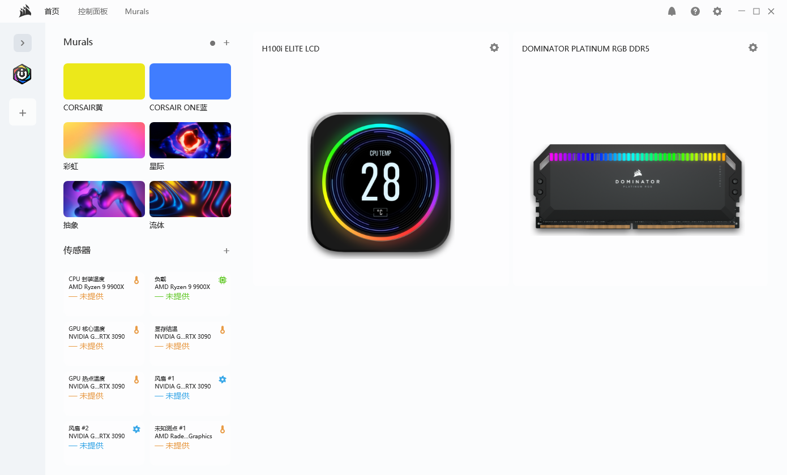
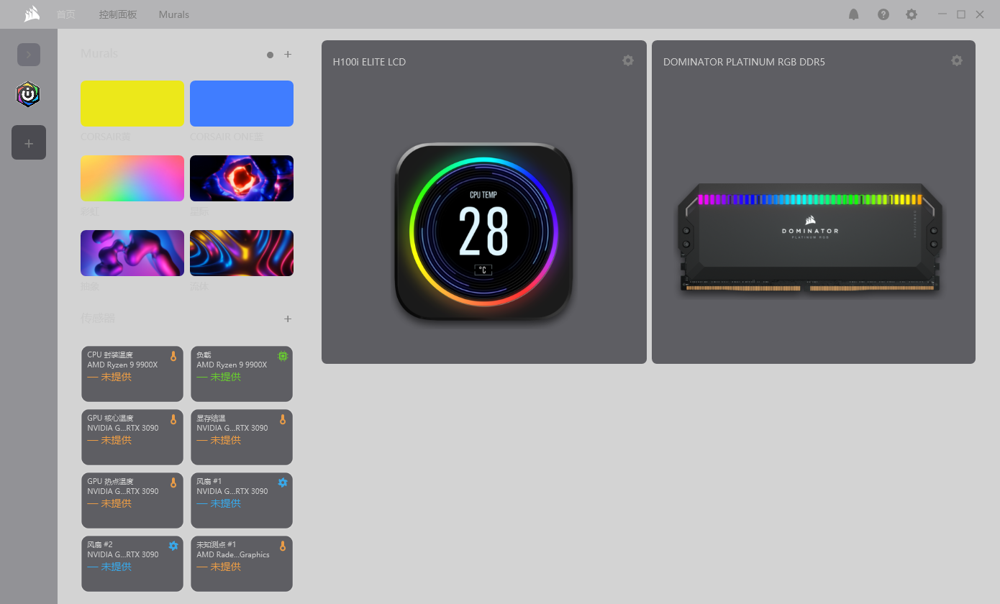
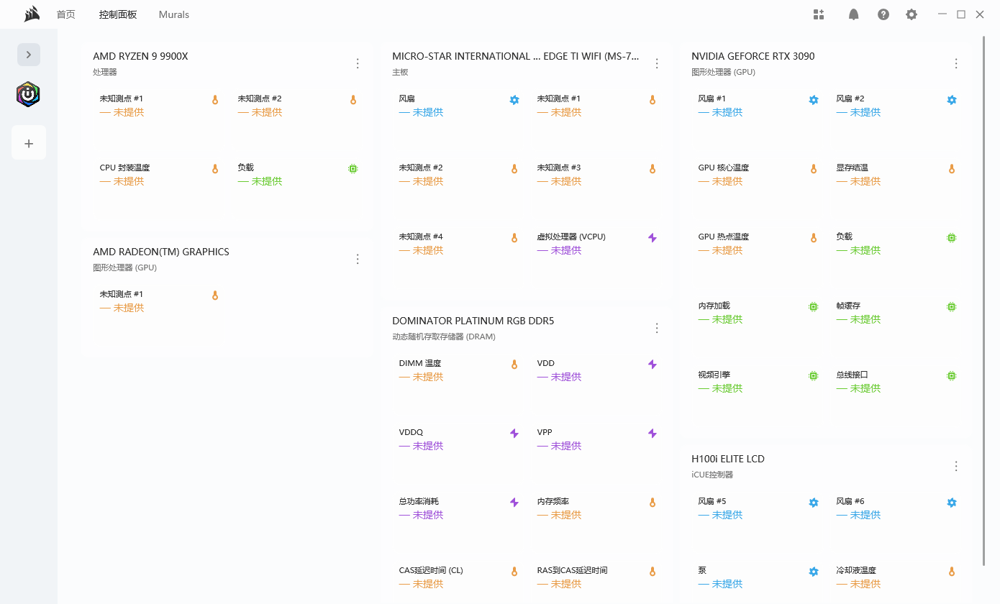
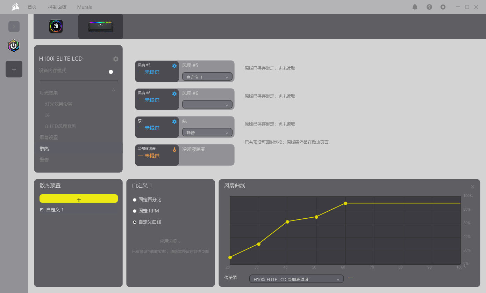
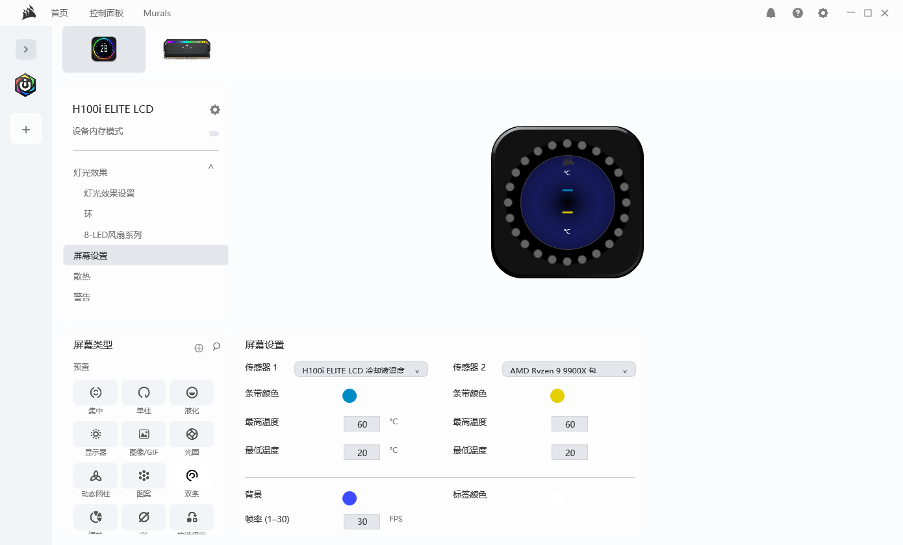
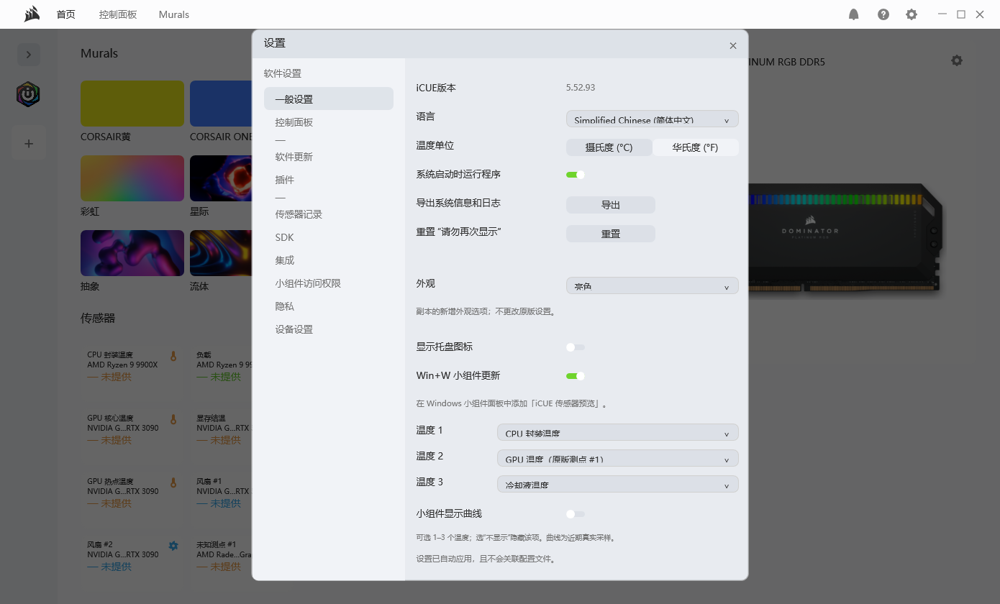

# iCUE Next · Personal UI Demo

> **2026-10-23 新增独立发布：原版 iCUE 传感器小组件。** 修复启动连接慢和首次打开先显示无数据再出现曲线的问题；支持双击打开原版 iCUE。无需运行 Next Demo。[下载小组件](https://github.com/Tomclanc/iCUE-Next-Demo/releases/tag/widgets-2026-10-23) · [安装与源码构建说明](widgets/README.md)。原来的 **15:23 Demo 发布包和效果图保持不变**。以下 Demo 说明中的“不附带小组件/传感器桥”仅指原 UI Demo ZIP；小组件另包提供，官方界面补丁仍未发布。


**按我个人审美做的一个 iCUE 界面 demo。**

主要是想试试：如果保留熟悉的设备页面和操作布局，把亮色、深色、圆角、卡片和 Windows 11 的观感重新整理一下，会是什么样子。

这是个人试作，非 CORSAIR 官方项目，也没有得到官方背书。**不作为原版 iCUE 的替代品，日常使用建议优先选择官方原版。**

本次公开的是 **2026-10-20「15:23 保留版」**，后续对原版 iCUE 制作的主题补丁不在这个仓库里。

[下载界面 Demo](https://github.com/Tomclanc/iCUE-Next-Demo/releases/tag/demo-2026-10-20-1523) · [效果图](#效果图) · [构建说明](#从源码构建)

## 效果图

以下效果图由保留版原始 EXE 的内置验证模式渲染，未接入实时传感器。设备图片上的数字是示意贴图，卡片中的“未提供”表示没有可用读数；效果图用于展示外观，不代表所有设备和控制功能已可用。

### 亮色



### 深色



### 控制面板



### 散热曲线界面



### LCD 屏幕设置



### 一般设置



更多截图：[Murals](docs/screenshots/light-murals.png)、[灯光页面](docs/screenshots/dark-lighting.png)。

## 这个 demo 做了什么

- 亮色、深色和跟随系统；Windows 11 Mica、圆角与托盘交互。
- 主页、设备卡片、控制面板、Murals 与设置页面的界面试作。
- 卡片排序、传感器选择、曲线节点拖拽、灯光与 LCD 设置等交互探索。
- 三项温度和曲线显示的小组件设置界面。

## 下载与运行

从 Releases 下载 `iCUE-Next-Demo-1523-UI.zip`，解压后运行 `iCUE-Replica.exe`。文件名保留原样，主程序与本地 15:23 保留版一致，没有为此次发布重新编译。

测试环境：Windows 11 x64、.NET Framework 4.8，参考官方 iCUE 5.52.93。

**公开包定位为界面预览。** 不附带作者本机配置、传感器快照、日志、签名证书、Windows 小组件安装包、传感器桥或 LCD 渲染运行库，也不包含 CORSAIR 官方程序 DLL。没有这些组件时，部分温度、动画和设备联动不可用。仅有小组件设置界面，不会自动安装 Windows 小组件。

程序保留了该版已有的实验联动入口：在原版 iCUE 运行且主动使用相关控件时，部分操作可能影响原版用户配置或设备设置。它不是一个承诺完全只读的沙盒；此公开版建议用于浏览界面和研究交互，不用于日常散热控制。私有接口与 UI 自动化依赖特定设备、软件版本和窗口状态，未做通用兼容性保证。

本地 demo 配置保存于 `%LOCALAPPDATA%\CueReplicaPreview`。退出并删除解压目录即可移除 demo；不需要更改官方安装目录。

## 从源码构建

源码为 C# / WPF；图像资源在 `src/assets` 中。

```powershell
powershell -NoProfile -ExecutionPolicy Bypass -File .\src\build.ps1
```

使用 Windows 自带 .NET Framework x64 编译器，输出到仓库根目录的 `iCUE-Replica.exe`。源码中的可选桥接与渲染脚本单独保留供研究，本仓库不提供相关运行库的打包产物。

## 范围与状态

这是按作者自己的审美和硬件环境制作的 demo，不追求功能与原版完全一致，也没有充分的跨设备稳定性测试。截图展示的是这一版的外观，不能当作实时硬件控制、动画逐帧一致或完整设备支持的证明。

本次发布仅整理了源码、说明、效果图及原始主程序；未包含后来制作的官方界面补丁、独立传感器试验版或服务试验版。

## 名称与素材

CORSAIR、iCUE、相关标识、设备图片、原版图标和参考素材归各自权利人所有，仅用于此非官方界面试作的展示和研究。第三方素材不会因为出现在仓库中就获得新的授权；详见 [THIRD_PARTY_NOTICES.md](THIRD_PARTY_NOTICES.md)。

This is an unofficial personal UI prototype based on my own visual preferences. It is not affiliated with, endorsed by, or a replacement for CORSAIR iCUE.
